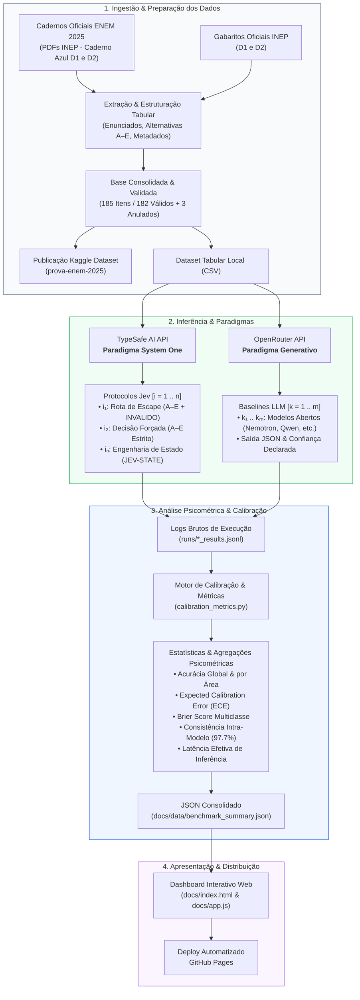

# Jev no ENEM: Avaliação Psicométrica e Calibração de Modelos System One no ENEM 2025

[](https://www.kaggle.com/datasets/serenozin/prova-enem-2025/data)
[-emerald)](https://typesafe.ai)
[](./spec/experimental_protocol.yaml)

Primeiro benchmark público avaliando o modelo **Jev (TypeSafe AI)** em exames padronizados brasileiros. Investigamos a transição do paradigma autorregressivo tradicional (LLMs generativas) para o paradigma **System One** (decisão tipada paralela, latência ultrabaixa e calibração de confiança via RLCD) aplicado aos Cadernos do **ENEM 2025** (Caderno Azul - 1º e 2º Dias).

---

## 🎯 Destaques do Projeto

- **Paradigma System One vs Generativo:** Avaliação empírica entre decisão direta tipada via primitiva `Choice` (70–500 ms) versus geração discursiva token a token de LLMs abertas.
- **Fundamentação Psicométrica:** Alinhamento com a Teoria de Resposta ao Item (TRI / Modelo Logístico 3-PL) do INEP e análise da atratividade de distratores.
- **Calibração Formal de Incerteza:** Acurácia não é tudo. Mensuramos *Expected Calibration Error* (ECE) e *Brier Score Multiclasse* para verificar se a certeza do modelo reflete sua precisão empírica.
- **Engenharia de Estado:** Comparativo entre o estado bruto transcrito (`JEV-RAW`) e o estado estruturado/decomposto (`JEV-STATE`), mitigando *context rot*.
- **Produto Final Interativo:** Dashboard analítico hospedado em **GitHub Pages** consumindo diretamente dados consolidados em JSON.

---

## 📊 Dataset no Kaggle

Para seguir as melhores práticas de engenharia de dados e manter o repositório leve, os dados tabulares da prova do ENEM 2025 estão hospedados publicamente no Kaggle:

👉 **[Kaggle: Prova ENEM 2025 - Dataset Completo](https://www.kaggle.com/datasets/serenozin/prova-enem-2025/data)**

- `gabarito.csv`: Gabarito oficial do 1º Dia (`numero;lingua_opcao;gabarito`).
- `enem_2025_d1_questoes_gabarito.csv`: Questões unificadas com alternativas A–E (Linguagens e Humanas).
- `gabarito_d2.csv`: Gabarito oficial do 2º Dia (`numero;area;gabarito`).
- `enem_2025_d2_questoes_gabarito.csv`: Questões unificadas com alternativas A–E (Natureza e Matemática).

---

## 🔬 Análise de Consistência e Dinâmica do Escape (`INVALIDO`)

O benchmark avaliou o modelo em duas rodadas experimentais:
1. **Com Escape (`INVALIDO`):** O modelo pôde escolher entre A, B, C, D, E ou se abster quando julgasse as alternativas insuficientes ou ambíguas.
2. **Sem Escape (Decisão Forçada A–E):** O modelo foi compelido a distribuir probabilidades exclusivamente no espaço de respostas válidas.

### Achados Empíricos de Estabilidade:
* **Concordância Intra-Modelo de 97.7%:** Nos 86 itens em que o Jev tomou uma decisão firme na primeira rodada (sem marcar `INVALIDO`), ele repetiu **exatamente a mesma alternativa em 84 itens** na segunda rodada.
* **O Escape como Filtro Efetivo de Risco:** 
  - Nos itens que o modelo aceitou responder espontaneamente, a acurácia foi de **78.8%**.
  - Nos itens que o modelo havia rejeitado (`INVALIDO`), ao ser forçado a chutar na segunda rodada, a acurácia foi de **35.5%**. Isso comprova que a rota de fuga drenou itens de alta entropia e incerteza real.
* **Superação do Chute Aleatório:** Mesmo no conjunto de maior dificuldade/rejeição (onde a acurácia foi de 35.5%), o modelo superou com folga a linha de base do chute puramente aleatório (**20.0%**).
* **Decomposição do Erro de Calibração (ECE):** 
  - No teste com escape, como o `INVALIDO` foi contabilizado como erro frente ao gabarito do INEP, o ECE computou em **0.275**.
  - Ao remover a penalização do escape e avaliar a calibração estrita nas alternativas da prova, o ECE caiu para **0.078**, evidenciando que a confiança declarada pelo RLCD acompanha a acurácia empírica em todas as faixas de probabilidade.

### 🏆 Quadro Comparativo Consolidado (182 Itens Válidos):

| Modelo / Arquitetura | Paradigma | Acurácia Global | Linguagens | Humanas | Natureza | Matemática | ECE (Calibração) |
| :--- | :--- | :---: | :---: | :---: | :---: | :---: | :---: |
| **Jev 1.13.0 (Sem Escape)** | System One (Primitiva Choice) | **56.6%** (103/182) | **78.0%** | **73.3%** | 46.5% | 25.0% | **0.078** |
| **NVIDIA Nemotron 3 Super 120B** | Generativo Autorregressivo (MoE) | **56.0%** (102/182) | 64.0% | 64.4% | **53.5%** | **40.9%** | 0.235 |
| **NVIDIA Nemotron 3.5 Lightning** | Generativo Autorregressivo (MoE) | **46.2%** (84/182) | 62.0% | 53.3% | 41.9% | 25.0% | 0.228 |
| *Jev 1.13.0 (Com Escape - Acurácia Efetiva)* | System One (Filtro Ativo) | *78.8% (70/89)* | *78.8%* | *82.1%* | *77.3%* | *66.7%* | *0.275 (penalizado)* |

---

## 💡 Conclusões Empíricas do Estudo

A análise dos resultados experimentais consolidados revela três eixos conclusivos centrais:

### 1. Acurácia Global: Empate Técnico entre Paradigmas
Na pontuação bruta sem escape (182 itens válidos), o **Jev 1.13.0** obteve **56.6%** (103 acertos), estabelecendo um empate técnico rigoroso com o **Nemotron 3 Super 120B**, que atingiu **56.0%** (102 acertos). Ambos os modelos superaram substancialmente a linha de base puramente aleatória (**20.0%** para 5 alternativas) e o modelo compacto **Nemotron 3.5 Lightning** (**46.2%**). Isso demonstra que uma arquitetura discriminativa ultracompacta (*System One*) com saída tipada direta atinge o mesmo patamar resolutivo de um modelo generativo massivo de 120 bilhões de parâmetros no exame nacional brasileiro.

### 2. Perfil Cognitivo Segmentado por Área
As duas arquiteturas manifestaram especializações complementares bastante nítidas:
* **Domínio Textual e Interpretativo (Dia 1):** O Jev superou largamente as LLMs em **Linguagens e Códigos (78.0% vs 64.0%)** e **Ciências Humanas (73.3% vs 64.4%)**. Esse resultado confirma que o processamento discriminativo paralelo do Jev assimila com grande acuidade o contexto discursivo e a semântica em língua portuguesa, desarmando distratores do ENEM com eficácia superior.
* **Raciocínio Simbólico e Quantitativo (Dia 2):** O Nemotron 120B obteve vantagem em **Matemática (40.9% vs 25.0%)** e **Ciências da Natureza (53.5% vs 46.5%)**. O Jev, sem ferramentas acessórias (como calculadoras ou interpretadores de código) e com representação em texto puro sem formatação LaTeX avançada, sofre degradação em problemas que demandam encadeamento aritmético em múltiplos passos, operando em Matemática no nível basal do chute estatístico.

### 3. Calibração de Incerteza e Estabilidade: O Diferencial Qualitativo
A grande distinção prática do benchmark não reside apenas na acurácia, mas na **confiabilidade da incerteza**:
* **Alta Calibração do Jev (ECE = 0.078):** Diferente dos modelos generativos tradicionais, a probabilidade atribuída pelo Jev (via RLCD) acompanha a taxa de acerto observada ao longo de todos os intervalos de confiança. Quando o Jev declara confiança entre 80% e 100%, sua precisão empírica é de **89.1%**; quando opera entre 40% e 60%, sua taxa de acerto é de **50.0%**.
* **Superconfiança Crônica das LLMs (ECE = 0.228 – 0.235):** Os modelos Nemotron exibiram a descalibração típica de geradores de texto autorregressivos. No intervalo de 80% a 100% de confiança declarada, a acurácia do Nemotron 120B despencou para apenas **62.9%**, emitindo certezas categóricas em dezenas de respostas incorretas.
* **Consistência Intra-Modelo de 97.7%:** Nos 86 itens em que o Jev optou por responder na rodada com escape, ele manteve exatamente a mesma alternativa em 84 itens na rodada de decisão forçada. Além disso, a rota de escape provou filtrar com precisão os itens de maior entropia cognitiva: ao forçar o modelo a responder os itens que antes rejeitava, a taxa de acerto caiu para 35.5%, confirmando que a abstenção não era ruído estocástico, mas detecção real de baixa previsibilidade.

---

## 🏗️ Arquitetura do Benchmark

O fluxo de dados e inferência opera em pipeline modular, desde a extração dos cadernos oficiais até a publicação analítica interativa:



---

## 📂 Arquitetura do Repositório

```text
jev-no-enem/
├── spec/                                # Especificações formais e fundamentação
│   ├── experimental_protocol.yaml       # Protocolo experimental auditável
│   ├── dataset_schema.json              # Contrato estrutural JSON Schema dos dados
│   └── theoretical_framework.md         # Monografia conceitual completa
├── src/                                 # Módulos Python reprodutíveis
│   ├── evaluate_jev.py                  # Runner oficial com TypeSafe SDK / REST
│   ├── evaluate_openrouter.py           # Baselines generativos abertos (Gemma, Qwen)
│   └── calibration_metrics.py           # Cálculo analítico de ECE, Brier Score e latência
├── runs/                                # Saídas brutas de inferência (JSONL)
├── docs/                                # Dashboard Web Estático (GitHub Pages)
│   ├── index.html                       # Aplicação com Tailwind CSS
│   ├── app.js                           # Visualizações e gráficos interativos (Chart.js)
│   └── data/
│       └── benchmark_summary.json       # Agregados consumidos pela interface
├── pipeline.py                          # Script de validação e integridade local
├── AGENTS.md                            # Diretrizes de segurança e privacidade
└── README.md
```

---

## 🚀 Como Executar

### 1. Pré-requisitos
```bash
python3 -m venv .venv
source .venv/bin/activate
pip install typesafe-sdk httpx
```

### 2. Configuração de Variáveis de Ambiente
Copie o `.env.example` e configure sua chave da TypeSafe AI:
```bash
export TYPESAFE_API_KEY="seu_token_aqui"
```

### 3. Validação dos Dados Locais
```bash
python3 pipeline.py
```

### 4. Execução do Benchmark
```bash
# Rodada Baseline (Zero-shot puro)
python3 src/evaluate_jev.py raw_baseline

# Rodada com Estado Estruturado Decomposto
python3 src/evaluate_jev.py informative_decomposed
```

---

## 📌 Escopo Analítico, Limites da Análise e Próximos Passos

Para assegurar uma leitura técnica fidedigna das análises e delimitar a maturidade dos achados, este estudo estabelece premissas e limites metodológicos explícitos:

### 1. Limites da Análise e Estudo Preliminar
* **Amostragem Preliminar de Execuções (Ausência de Múltiplos Runs / Bootstrap):**
  Os dados atuais representam uma avaliação preliminar (duas rodadas experimentais para o Jev — com e sem escape — e uma rodada completa para cada baseline generativo). Para consolidação de significância estatística formal e intervalos de confiança estritos, rodadas adicionais sob técnica de *bootstrapping* ou repetições sob diferentes sementes estocásticas são necessárias em trabalhos futuros.
* **Seleção de Baselines Generativos (Custo vs SOTA):**
  Os modelos de comparação utilizados (**NVIDIA Nemotron 3.5 Lightning** e **Nemotron 3 Super 120B**) foram selecionados pelo critério de viabilidade econômica e paridade de custos em provedores abertos, e **não** como representantes do estado da arte absoluto (SOTA) da indústria (tais como GPT-4o, Claude 3.7 Sonnet ou Gemini 1.5 Pro). O objetivo foi contrastar o paradigma discriminativo com modelos generativos de código aberto acessíveis sob restrições realistas de engenharia.
* **Roteamento de Rede vs Latência Intrínseca:** 
  A inferência do modelo **Jev** foi realizada via conexão direta com o endpoint oficial do provedor ([TypeSafe AI](https://typesafe.ai)), enquanto os baselines de LLM foram roteados via pool público do OpenRouter. Em nós gratuitos, incidem esperas em fila (*queue times*) e latências de rede flutuantes. Portanto, a latência observada das LLMs reflete o canal de acesso utilizado, e **não** a velocidade intrínseca de processamento desses modelos em hardware dedicado.
* **Representação Textual de Fórmulas e Imagens:**
  O ENEM é um exame multimodal que contém diagramas, gráficos e charges. Neste benchmark, as questões foram avaliadas em formato puramente textual extraído dos cadernos oficiais. O desempenho em Matemática e Ciências da Natureza reflete essa limitação representacional.

### 2. O que este estudo **EFETIVAMENTE** investiga
* **Calibração de Incerteza versus Acurácia Empírica:** 
  Avaliar se a confiança declarada reflete a probabilidade real de acerto (medida via *Expected Calibration Error* - ECE e *Brier Score*). Enquanto LLMs generativas frequentemente incorrem em superconfiança mesmo no erro, investiga-se o comportamento do *Reinforcement Learning for Calibrated Decisions* (RLCD) do Jev e sua capacidade de sinalizar incerteza (por exemplo, através da alternativa de escape `INVALIDO`).
* **Estruturação Nativa vs Extração via JSON Forçado:** 
  Medir a robustez de um modelo nativamente tipado (*System One*) em comparação à indução de esquemas sintáticos em LLMs via prompt zero-shot e pós-processamento.
* **Desempenho Segmentado pela Matriz do ENEM:** 
  Identificar como os modelos se comportam nos diferentes domínios cognitivos do exame (Linguagens, Ciências Humanas, Ciências da Natureza e Matemática).
* **O Efeito da Língua Portuguesa frente aos Relatórios Oficiais:**
  No [manifesto de lançamento da TypeSafe AI](https://typesafe.ai/blog/introducing-system-one-models-and-jev) (referente à versão de lançamento **Jev 1.13**), o modelo foi calibrado e avaliado prioritariamente sobre tarefas e corpora em língua inglesa (com médias divulgadas em torno de 67.8% de acurácia no benchmark interno de 4 fluxos de trabalho). Um dos objetivos centrais desta pesquisa é avaliar a capacidade de generalização do Jev no idioma português diante da complexidade interpretativa e dos distratores característicos do ENEM brasileiro.

### 3. Próximos Passos de Pesquisa
1. **Engenharia de Estado (JEV-STATE):** Avaliar o impacto da decomposição estruturada do enunciado e alternativas (evitando *context rot*) em relação ao texto bruto.
2. **Repetições e Bootstrap Estatístico:** Executar $N$ iterações sob diferentes temperaturas e parâmetros para calcular intervalos de confiança de 95% para acurácia e ECE.
3. **Expansão de Baselines:** Incorporar modelos de raciocínio (*reasoning models*) e modelos proprietários de ponta para traçar a fronteira de eficiência custo-benefício.

---

## 🤖 Declaração de Uso de Inteligência Artificial

Em consonância com as boas práticas de integridade científica e diretrizes éticas para pesquisa tecnológica (como as orientações do CNPq e periódicos de referência sobre transparência no uso de ferramentas generativas):

* **Assistência de IA:** Este repositório e seus artefatos foram desenvolvidos em colaboração com o modelo de linguagem **Gemini 3.8 Flash** (Google DeepMind).
* **Natureza da Aplicação:**
  1. **Pesquisa Automatizada e Levantamento Bibliográfico:** Mapeamento de literatura acadêmica sobre Teoria de Resposta ao Item (TRI 3-PL), RLCD, métricas de calibração (*Expected Calibration Error* e *Brier Score*) e documentação técnica da TypeSafe AI.
  2. **Engenharia de Software e Scripts:** Escrita e refatoração dos scripts de extração, consolidação de dados e runners de inferência em Python.
  3. **Gerenciamento de Versão e Arquitetura:** Estruturação da metodologia *Spec-Driven Analysis*, contratos JSON Schema e organização dos commits padronizados.
  4. **Redação Técnica:** Apoio na estruturação formal de documentações, mantendo a autoria, revisão crítica e validação experimental sob responsabilidade integral do autor (**Patryck Alves**).

---

## 🛡️ Diretrizes de Segurança (AGENTS.md)
Este repositório é público. Qualquer modificação por agentes autônomos ou assistentes de IA segue as diretrizes do [AGENTS.md](AGENTS.md), garantindo ausência de credenciais, logs transitórios ou vazamentos de contexto em commits e documentações.
