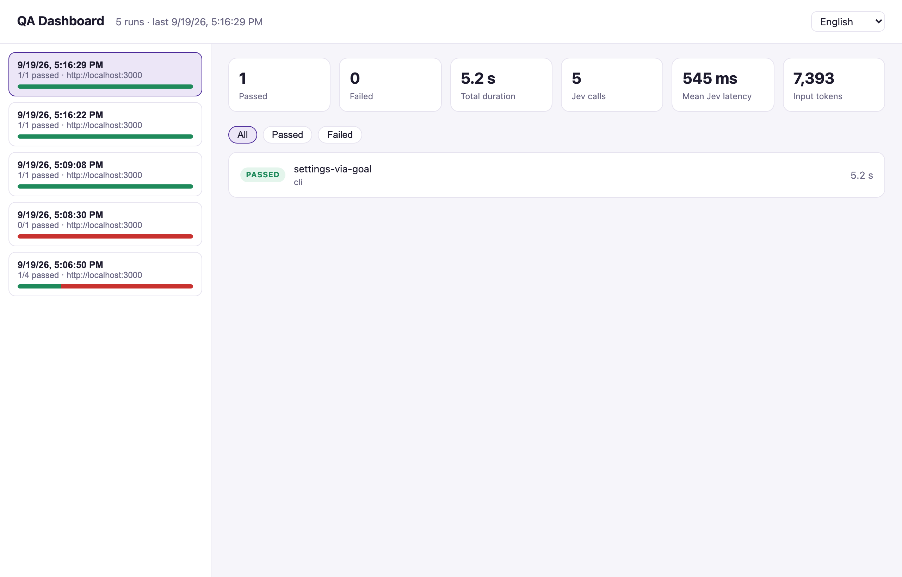
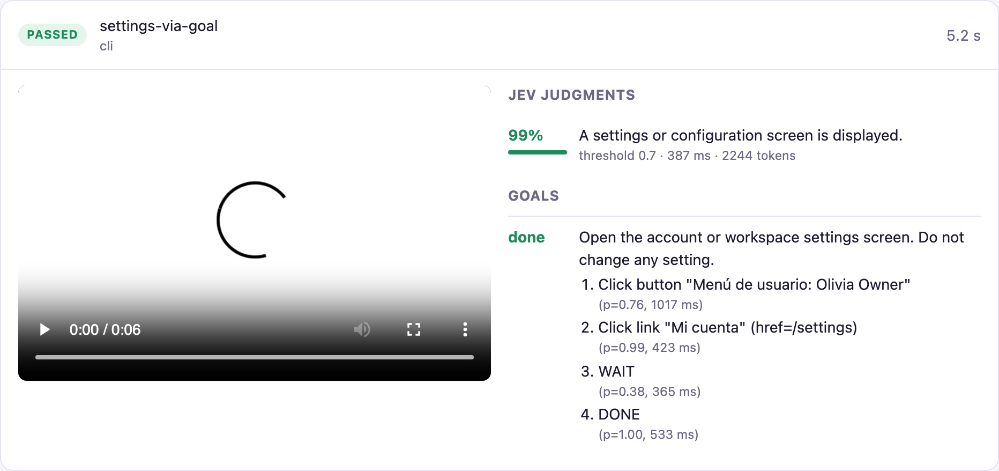

<div align="center">

# jev-browser-qa

**Browser QA where Playwright drives and films, and Jev judges.**

Natural-language assertions, self-healing locators and goal-driven click loops, powered by a model that answers in under 400 ms and never generates a token.

[](https://github.com/jonymusky/jev-browser-qa/actions/workflows/ci.yml)
[](LICENSE)
[](package.json)
[](https://playwright.dev)
[](https://typesafe.ai)

[Quick start](#quick-start) · [How it works](#how-it-works) · [CLI](#the-cli) · [Primitives](#primitives-for-playwright-tests) · [Dashboard](#dashboard) · [Agents](#for-coding-agents) · [Numbers](#numbers) · [FAQ](#faq)



</div>

## Why

Most of an end-to-end test is mechanical: navigate, type, wait. The hard part is judgment: *did that work?*, *which button is "create"?*, *how do I get to settings from here?* Today that judgment either lives in brittle selectors and `expect(text).toContain()` or in a frontier LLM that spends a full turn per click.

[Jev](https://typesafe.ai) is a different kind of model. It takes a state and typed questions (yes/no, one-of, score) and returns calibrated probabilities. No text, no selectors, no tool calls, zero output tokens. That makes it fast enough and cheap enough to ask on every step. This project puts it exactly where it belongs:

| | Playwright (code) | Jev (model) |
|---|:---:|:---:|
| Navigation, typing, waiting | ✅ | |
| Video, trace, screenshots | ✅ | |
| "Does this claim hold on the page?" | | ✅ `expect` |
| "Which visible control matches this intent?" | | ✅ `click` / `pick` |
| "What is the next click toward this goal?" | | ✅ `goal` / `runGoal` |

Text entry is never delegated to the model. Jev sees text (URL, title, visible text, aria tree), not pixels. Jev is served through the [Vercel AI Gateway](https://vercel.com/ai-gateway) via the AI SDK's `experimental_evaluate`, so one `AI_GATEWAY_API_KEY` is the whole configuration.

## Features

- **JSON-flow CLI for agents.** Run a flow, get one JSON result: pass/fail per step, the probability behind each judgment, a video and a final screenshot. Exit code 0/1. Secrets referenced as `${QA_EMAIL}` placeholders, never seen by the agent.
- **Three primitives for your own Playwright tests.** `expectPage`, `pick`, `runGoal`.
- **Every run recorded.** MP4 (H.264) when ffmpeg is installed, WebM otherwise. Trace on failure.
- **Local dashboard.** Run history, KPIs, every Jev decision with probability, latency and tokens, the video inline. English, Spanish and Portuguese. Nothing leaves your machine.
- **Agent skill.** `skills/jev-qa/SKILL.md` teaches Claude Code, Codex, Cursor and friends how to write flows and read results.
- **Telemetry built in.** Every Jev call logs latency and tokens; zero-data-retention routing is requested per call.

## Quick start

Requirements: Node 22+, pnpm, an [AI Gateway key](https://vercel.com/docs/ai-gateway), and an app to test. `ffmpeg` on the PATH is optional but recommended (`brew install ffmpeg`) so recordings play in Safari.

```bash
git clone https://github.com/jonymusky/jev-browser-qa && cd jev-browser-qa
pnpm install
pnpm exec playwright install chromium
cp .env.example .env        # AI_GATEWAY_API_KEY, BASE_URL, QA_EMAIL, QA_PASSWORD
pnpm jev:smoke              # one gateway call, no browser: verifies the key and the model
```

Run a flow:

```bash
pnpm -s qa run flows/login.json
```

```
[1/9] goto: /auth/login
    passed (1072 ms)
[2/9] expect: This is a login page asking for an email address.
    passed p=0.98 (633 ms)
...
[7/9] click: the button that submits the login form
    Jev picked button "Iniciar sesión" p=0.97
    passed p=0.97 (366 ms)
[8/9] waitForUrl: !/auth/login
    passed (347 ms)
[9/9] expect: The user is signed in and sees the main application navigation, not a login form.
    passed p=0.97 (512 ms)
{
  "status": "passed",
  "video": ".../artifacts/flows/<runId>/video.mp4",
  "finalScreenshot": ".../artifacts/flows/<runId>/final.png",
  "jev": { "calls": 3, "inputTokens": 2255, "apiMs": 1261 }
}
```

Open the dashboard:

```bash
pnpm dashboard              # http://localhost:4310
```

<div align="center"></div>

## How it works

```
 flow.json ──► CLI ──► Playwright ──► page
                │                      │
                │      snapshotPage()  │  url, title, visible text, aria tree,
                │◄─────────────────────┘  visible controls tagged data-jev-idx
                │
                ├── expect ──► Jev boolean  ──► probability ≥ threshold ?
                ├── click  ──► Jev choice   ──► one of the tagged controls (or NONE)
                └── goal   ──► Jev choice   ──► click / scroll / DONE / BLOCKED / WAIT, repeat ≤ maxSteps
```

1. `snapshotPage()` (`src/jev/snapshot.ts`) captures what the model needs and tags every visible clickable control with an index. The model chooses among what code found; it never invents a selector.
2. `askJev()` (`src/jev/client.ts`) is the single entry point to the model: `gateway.evaluationModel('typesafe-ai/jev')`, retries, ZDR, latency and token logging.
3. Evidence (judgment JSON, screenshots, goal histories) flows to the Playwright report inside the test runner, or to the CLI's collector, through one `attachEvidence()` sink.
4. A custom reporter and the CLI both write `artifacts/runs/<runId>.json`, which the dashboard reads.

## The CLI

```
pnpm -s qa run <flow.json> [--json] [--headed] [--base-url <url>]
pnpm -s qa run --steps '<json array>' --name <flow-name> [--json]
pnpm -s qa steps            # prints the step schema
```

`--json` keeps stdout to the result JSON only; progress goes to stderr. Exit code `0` passed, `1` failed, `2` usage or configuration error. Each run writes `artifacts/flows/<runId>/{video.mp4|webm,final.png,result.json}`.

### Steps

A flow is `{ "name": string, "baseUrl"?: string, "steps": Step[] }`. One key per step; the first failure skips the rest. Strings accept `${ENV_VAR}` substitution.

| Step | Executed by | Purpose |
|---|---|---|
| `{"goto": "/path"}` | Playwright | navigate |
| `{"fill": "<selector>", "value": "${QA_EMAIL}"}` | Playwright | type text |
| `{"press": "<selector>", "key": "Enter"}` | Playwright | key press |
| `{"clickSelector": "<selector>"}` | Playwright | click a known selector |
| `{"click": "the button that submits the form"}` | Jev picks | click by intent among the visible controls |
| `{"expect": "<claim>", "threshold"?: 0.7, "criteria"?: {"true": "...", "false": "..."}}` | Jev judges | assertion in plain language |
| `{"goal": "<goal>", "maxSteps"?: 8, "denyNames"?: [...], "allowNames"?: [...]}` | Jev chooses each click | reach a screen without scripting the path |
| `{"waitForUrl": "!/auth/login"}` | Playwright | `!` prefix: until the URL no longer contains it |
| `{"waitForSelector": "#password"}` | Playwright | wait for visibility |
| `{"wait": 1500}` | Playwright | fixed pause |
| `{"screenshot": "name"}` | Playwright | extra PNG |

`flows/` has three examples against a two-step login (email, then password). Adapt the selectors to your app.

### Result shape

```jsonc
{
  "status": "passed" | "failed",
  "finalUrl": "http://localhost:3000/settings",
  "video": "/abs/artifacts/flows/<runId>/video.mp4",
  "finalScreenshot": "/abs/artifacts/flows/<runId>/final.png",
  "steps": [
    { "index": 7, "step": { "goal": "..." }, "status": "passed", "ms": 3245, "goalStatus": "done", "url": "..." },
    { "index": 8, "step": { "expect": "..." }, "status": "passed", "ms": 443, "probability": 0.99, "url": "..." }
  ],
  "jev": { "calls": 5, "inputTokens": 7393, "apiMs": 2725 }
}
```

## Primitives for Playwright tests

```ts
import { test } from '@playwright/test';
import { expectPage, pick, runGoal } from '../src/jev/index.js';

test('create a job position', async ({ page }) => {
  await login(page);                                    // your deterministic helper
  const target = await pick(page, 'the button that creates a new job position');
  await target.locator.click();
  await expectPage(page, 'A form to create a job position is displayed.');

  const outcome = await runGoal(page, {
    goal: 'Open the workspace settings screen. Do not change any setting.',
    policy: { denyNames: [/logout/i, /delete/i, /save/i] },
  });
  test.expect(outcome.status).toBe('done');
});
```

- **`expectPage(page, claim, { threshold?, criteria? })`** asks a boolean question over the page state and fails with the probability. Attaches the judgment JSON and a screenshot to the report. `judge()` is the non-throwing form.
- **`pick(page, intent)`** lists the visible clickable controls, lets Jev choose one, returns a Playwright `Locator`. Throws on `NONE` or low confidence.
- **`runGoal(page, { goal, policy, maxSteps })`** is a bounded loop adapted from [jev-browser-use](https://github.com/wy-coliney/jev-browser-use): per step Jev picks one of the unique visible controls, a scroll, or `DONE` / `BLOCKED` / `WAIT`. Ambiguous (duplicate) names and `denyNames` matches are never offered.

`pnpm test` runs `tests/` with video on for every test; `pnpm report` opens Playwright's HTML report. The runner and the CLI feed the same dashboard.

## Dashboard

`pnpm dashboard` serves a dependency-free page on port 4310 (`DASHBOARD_PORT` to change). It reads `artifacts/runs/*.json`:

- runs in the sidebar with a pass/fail bar and the target URL;
- per run: passed, failed, total duration, Jev calls, mean latency, input tokens;
- per test: status, error line, the video inline (with Range support, so seeking works), trace, every judgment with probability, threshold, latency and the screenshot taken at judgment time, and every goal loop with its steps.

The language follows the browser (English, Spanish, Portuguese) and can be switched in the header.

## For coding agents

```bash
npx skills add https://github.com/jonymusky/jev-browser-qa --skill jev-qa
```

The skill explains when to use the CLI, the step table, rules for good flows and how to read a result. Outside this repository it resolves the CLI through `JEV_QA_DIR`:

```bash
export JEV_QA_DIR=/path/to/jev-browser-qa
```

Then a prompt such as *"test this branch in the browser with jev-qa; use `${QA_EMAIL}` placeholders, report status, the failing step and the video path"* is enough.

The repository also ships an `AGENTS.md`, and the skill is linked from `.agents/skills/`, `.claude/skills/` and `.grok/skills/`, so **Claude Code**, **Codex**, **Cursor** and **Grok Build** pick it up inside the repo with no setup.

### Grok Build

[Grok Build](https://docs.x.ai/build/overview), xAI's terminal agent, reads Agent Skills and `AGENTS.md` natively:

```bash
curl -fsSL https://x.ai/cli/install.sh | bash
npx skills add https://github.com/jonymusky/jev-browser-qa --skill jev-qa --agent grok
grok -p "Use the jev-qa skill to run flows/login.json against http://localhost:3000 and summarize the result."
```

Full walkthrough in [docs/agents/grok-build.md](docs/agents/grok-build.md).

There is also a ready-made Grok bot, **[QA Engineer](https://x.ai/bot/IoOXnqvhpn4i_C1TNq9P_)**, preloaded with this skill: it runs browser QA flows with Playwright + Jev and returns pass/fail with the video and the screenshot. Open the link, point it at your app, and describe the flow you want verified.

## Numbers

Measured through AI Gateway from Buenos Aires, 20 sequential calls, one boolean plus one choice question over a ~400-token page state:

| Jev via AI Gateway | |
|---|---|
| p50 / p90 latency (round trip) | 388 ms / 471 ms |
| min / max | 330 ms / 883 ms |
| Input tokens per judgment / per goal step | ~400 / ~1,500 |
| Price | USD 0.042 per 1M input tokens, output free |
| Cost of the 5-decision settings flow above | USD 0.0003 |

The write-up with a cost and latency comparison against current LLMs is on the blog: [Jev doesn't generate. That's the point.](https://me.jonymusky.com/blog/jev-system-one-browser-qa)

## Configuration

| Variable | Default | Purpose |
|---|---|---|
| `AI_GATEWAY_API_KEY` | | Vercel AI Gateway key |
| `BASE_URL` | `http://localhost:3000` | app under test |
| `QA_EMAIL`, `QA_PASSWORD` | | referenced by the example flows |
| `JEV_JUDGE_THRESHOLD` | `0.7` | minimum probability for an `expect` to pass |
| `JEV_ACTION_MIN_CONFIDENCE` | `0.55` | minimum probability for a `click` / `goal` action to run |
| `JEV_ZERO_DATA_RETENTION` | `true` | request ZDR routing on the gateway |
| `FFMPEG_PATH` | `ffmpeg` | ffmpeg binary used to produce MP4 recordings |
| `DASHBOARD_PORT` | `4310` | dashboard port |

## Writing good claims

- State an observable outcome: *"A list of job positions is displayed, or an empty state inviting to create the first one"*.
- Add `criteria.false` for the failure you actually fear: *"A loading shell, an error, or no billing information is shown"*.
- One judgment per claim. Two claims in one sentence hide which half failed.
- A probability near the threshold is a signal to sharpen the claim, not to lower the threshold.

## FAQ

**Can Jev drive the whole test by itself?** No, by design. It cannot type, plan or generate. Code owns the flow; Jev answers questions inside it. That is what makes it fast and predictable.

**Does it see the screenshot?** No. Text and the aria tree only. Visual regressions need a vision model or a pixel diff; the screenshots here are for humans.

**Why not use the TypeSafe API directly?** You can: the HTTP API is `POST https://api.typesafe.ai/v1/systemone`. The gateway path was chosen because one key covers Jev and every other model, with spend budgets and ZDR in one place. Swapping `askJev()` is a 20-line change.

**Videos do not play in Safari.** Playwright records WebM, which Safari cannot decode. Install ffmpeg and the next runs produce MP4; the dashboard says so when it serves a WebM.

**`ReferenceError: __name is not defined` inside `page.evaluate`.** tsx/esbuild injects a helper into serialized functions. Browser-side code in this repo is kept as a string for that reason (`src/jev/snapshot.ts`).

## Roadmap

- [ ] `select`, `upload` and `hover` steps
- [ ] Score-based ranking of candidate controls when several match an intent
- [ ] Vision fallback for `expect` on pixel-only claims
- [ ] GitHub Action that runs a flow against a PR preview and comments the verdict with the video
- [ ] MCP server exposing `qa run` to agents that cannot shell out

## Contributing

See [CONTRIBUTING.md](CONTRIBUTING.md). Small PRs, conventional commits, keep Jev a judge.

## Acknowledgements

[TypeSafe](https://typesafe.ai) for Jev and the System One docs, [Vercel](https://vercel.com/ai-gateway) for `experimental_evaluate` and the gateway, and [jev-browser-use](https://github.com/wy-coliney/jev-browser-use) for the action-loop design this adapts.

## License

[MIT](LICENSE) © Jonathan Muszkat
